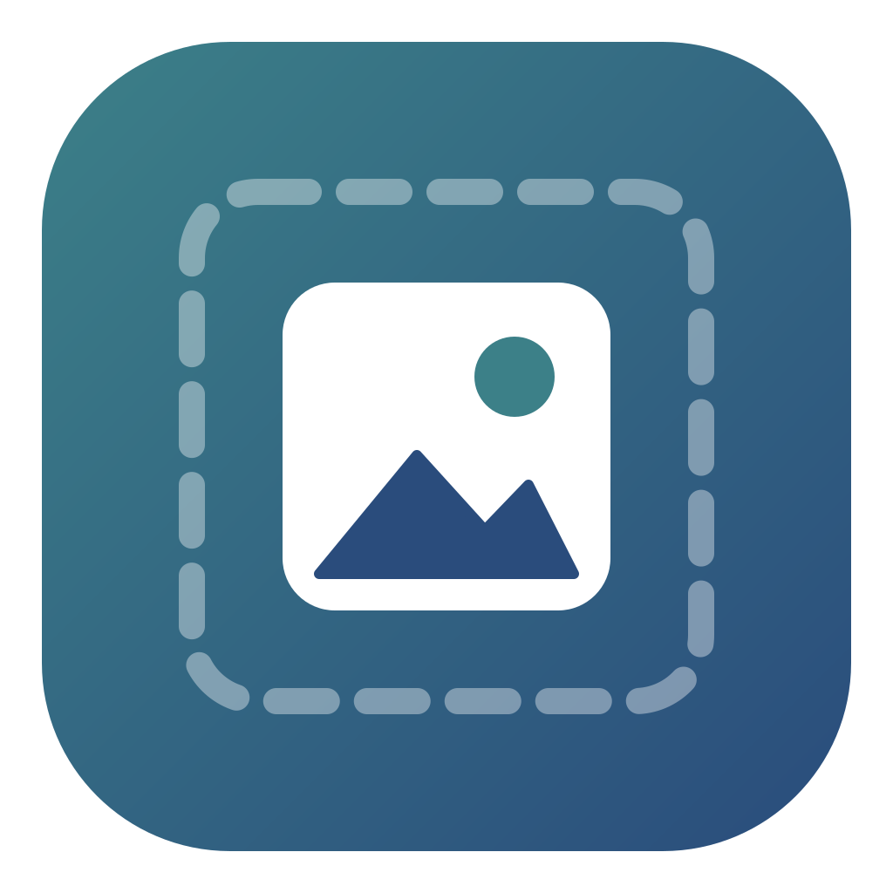

<p align="center"></p>

<h1 align="center">Imago — Image Optimizer</h1>
<p align="center"><b>Fast. Local. Smaller images. Zero cloud.</b></p>

<p align="center">
  <b>🇬🇧 English</b> &nbsp;|&nbsp; <a href="README.pl.md">🇵🇱 Polski</a>
</p>

---

Imago is a free, native, open-source desktop application and command-line tool designed to **compress, convert, and resize images entirely locally**. It works just like online image optimizers, but no file ever leaves your computer.

## Key Features

- **Drag and drop** files or entire directories (including subdirectories), or pick them using the native system file dialog.
- **Automatic mode** — compares multiple formats (WebP, AVIF, JPEG, PNG) for every image and saves the smallest one. Preserves transparency and animations, **never makes a file bigger**, and explains its decision, e.g. *“Selected WebP because it reduced file size by 71% while preserving transparency.”*
- **Input formats:** JPEG, PNG (including APNG), WebP, AVIF, GIF, JPEG XL (all including animated variants), HEIC/HEIF (iPhone photos), TIFF, BMP.
- **Output formats:** JPEG (MozJPEG), PNG (lossy quantization like TinyPNG or lossless, including animated APNG), WebP, AVIF, TIFF, JPEG XL (lossy and lossless). Animations can be saved as WebP, APNG, AVIF, JPEG XL, or GIF.
- **Large image mode:** JPEG and PNG files exceeding pixel dimension thresholds (e.g. 30,000 px panoramas) are processed in scanline strips, with memory usage bound to image width rather than total image area.
- **Quality 1–100**, lossless mode, and maximum compression mode.
- **Resizing:** width, height, aspect ratio preservation, maximum bounding box, percentage scaling.
- **Metadata handling:** EXIF stripping (GPS, camera info), ICC color profile preservation (or conversion to sRGB), EXIF auto-rotation, modification timestamp preservation. JPEG/PNG/WebP metadata can be stripped without re-encoding.
- **Safe atomic writes:** Output is initially written to a temporary file, verified, and atomically moved into place. Originals are never overwritten without explicit confirmation.
- Output to `optimized` folder, custom output directory, custom name suffix, folder structure preservation, name collision handling.
- **Before/After preview** with side-by-side comparison slider, size statistics, percentage reduction, and processing duration.
- **ZIP archive** export, single-image “Save as…”, direct “Open output directory”.
- Progress bar for the overall queue and per-file progress, cancel, skip individual file, retry.
- Light, dark, and system themes, Polish and English user interface, keyboard shortcuts, sorting and filtering.
- **CLI `imago`** powered by the exact same engine and settings as the desktop GUI.

## Privacy

- Exclusively local processing, works completely offline;
- No accounts, no sign-in, no advertisements, no telemetry, and no external trackers;
- The app contains no networking code, and the window's Content Security Policy (CSP) blocks external connections;
- Settings are stored locally without file history; diagnostic logs (paths and errors only, no image content) remain on disk and are rotated after 7 days.

## Installation

Pre-built packages (Windows `.msi`/`.exe`, macOS `.dmg`, Linux `.deb`/`.rpm`/`.AppImage`) and CLI archives are published under the *Releases* tab. Building from source and system requirements: **[docs/INSTALL.md](docs/INSTALL.md)**.

Quick start from source (Windows, macOS, Linux):

```bash
npm install
npm run tauri dev
```

Required toolchain: Rust stable ≥ 1.93, Node.js 20.19+ / 22+, C compiler, **NASM** (build-time only), WebKitGTK on Linux. The packaged application has no runtime dependencies other than the operating system WebView.

## Command Line Interface

```bash
imago input.jpg --output optimized.jpg --format webp --quality 82
imago ./photos --output ./optimized --format auto --quality 82
imago ./photos --output ./optimized --recursive --workers 8
imago ./photos --output ./optimized --width 2400 --remove-metadata
imago ./photos --output ./optimized --format avif --quality 70
imago ./photos --output ./optimized --lossless
imago ./photos --output ./optimized --skip-existing
imago ./photos --zip photos.zip --json
imago --help
```

Full description of flags and exit codes: **[docs/CLI.md](docs/CLI.md)**.

## Performance

- Files are processed concurrently using a worker thread pool (defaults to logical core count − 1);
- Memory budget caps concurrently decoded large images; dimensions and byte sizes are verified from file headers **before** decoding (protection against decompression bombs);
- SIMD resizing (Lanczos3), native statically-linked codecs (MozJPEG, libwebp, rav1e, libimagequant, libdeflate);
- Streaming frame-by-frame pipeline for animated images;
- Fully virtualized UI list — thousands of files can be queued without rendering lag.

Benchmark results and instructions: **[docs/PERFORMANCE.md](docs/PERFORMANCE.md)**.

## Documentation

| Document | Content |
|---|---|
| [docs/INSTALL.md](docs/INSTALL.md) | Installation, development setup, release build, Windows / macOS / Linux |
| [docs/CLI.md](docs/CLI.md) | CLI documentation and usage instructions |
| [docs/FORMATS.md](docs/FORMATS.md) | Supported formats and conversion modes |
| [docs/PIPELINE.md](docs/PIPELINE.md) | 23-step processing pipeline, safe atomic write |
| [docs/ARCHITECTURE.md](docs/ARCHITECTURE.md) | Architecture, multi-threading, memory limits, cancellation |
| [docs/LIMITATIONS.md](docs/LIMITATIONS.md) | Known limitations |
| [docs/TROUBLESHOOTING.md](docs/TROUBLESHOOTING.md) | Troubleshooting |
| [docs/PERFORMANCE.md](docs/PERFORMANCE.md) | Benchmarks |
| [docs/DECISIONS.md](docs/DECISIONS.md) | Architecture Decision Records (ADRs) |
| [CONTRIBUTING.md](CONTRIBUTING.md), [SECURITY.md](SECURITY.md) | Contributing guidelines, security vulnerability reporting |

## Known Limitations (Summary)

- JPEG XL is currently saved in lossless mode only (no stable CMake-free lossy encoder available); AVIF is lossy only.
- Animated AVIF and JPEG XL are preserved in original format (not re-encoded); APNG is not generated.
- Cancellation takes effect between processing stages — in-flight encoding of a large AVIF completes before stopping.
- Release installers are not digitally signed (Windows SmartScreen / macOS Gatekeeper may display an alert).

Full list: [docs/LIMITATIONS.md](docs/LIMITATIONS.md).

## License

Imago is free and open-source software licensed under **GNU GPL v3.0 or later** ([LICENSE](LICENSE)). This license is determined by the inclusion of libimagequant (lossy PNG quantization). Third-party dependencies: [THIRD_PARTY.md](THIRD_PARTY.md).
