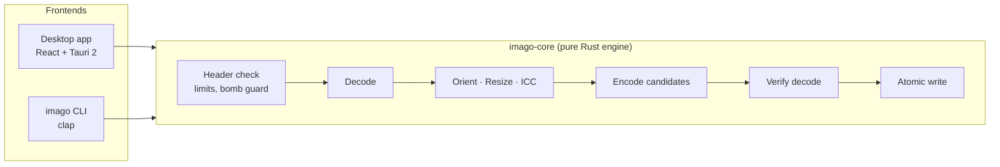

<p align="center">
  
</p>

<h1 align="center">Imago</h1>

<p align="center">
  <b>Fast. Local. Smaller images. Zero cloud.</b><br>
  A native desktop app and CLI that compresses, converts and resizes images — without a single byte leaving your machine.
</p>

<p align="center">
  <a href="https://github.com/wiktor-jozwiak/imago/actions/workflows/ci.yml"></a>
  <a href="https://github.com/wiktor-jozwiak/imago/releases/latest"></a>
  <a href="LICENSE"></a>
  
  
  
  
</p>

<p align="center">
  <b>🇬🇧 English</b> &nbsp;·&nbsp; <a href="README.pl.md">🇵🇱 Polski</a>
</p>

<p align="center">
  <a href="#-why-imago">Why</a> ·
  <a href="#-features">Features</a> ·
  <a href="#-formats">Formats</a> ·
  <a href="#-install">Install</a> ·
  <a href="#-cli">CLI</a> ·
  <a href="#-performance">Performance</a> ·
  <a href="#-how-it-works">How it works</a> ·
  <a href="#-documentation">Docs</a>
</p>

---

## ✨ Why Imago

Online optimizers are convenient — and they get a copy of every photo you upload. Imago does the same job **on your own CPU**:

|  | Online optimizers | **Imago** |
|---|---|---|
| Your files leave the computer | ✅ always | ❌ **never** — no networking code, CSP blocks outbound requests |
| Works offline | ❌ | ✅ |
| Batch size / file size limits | 20 files, 5 MB… | thousands of files, 512 MB+ per file, 30 000 px panoramas |
| Picks the best format for you | sometimes | ✅ **Auto mode** compares WebP / AVIF / JPEG / PNG and explains the choice |
| Can make files bigger | sometimes | ❌ **never** — the original stays if nothing beats it |
| Accounts, ads, telemetry | usually | ❌ none |
| Scriptable | API keys, quotas | ✅ `imago` CLI, JSON reports, exit codes |
| Price | freemium | **free & open source (GPL-3.0)** |

> *“Selected WebP because it reduced file size by 71% while preserving transparency.”*
> — Imago explaining one of its Auto-mode decisions

## 🚀 Features

**Optimize**
- 🤖 **Auto mode** — encodes several candidates per image, keeps the smallest, preserves transparency and animation, and tells you *why*.
- 🎚️ Quality **1–100**, **lossless** mode, **maximum compression** mode, and a **fast** mode for big batches.
- 🧠 Lossy PNG quantization (TinyPNG-style, via libimagequant) or fully lossless PNG (oxipng).
- 🎞️ Animation-aware: GIF / APNG / WebP / AVIF / JPEG XL animations are kept animated, identical frames are merged.

**Transform**
- 📐 Resize by width, height, bounding box or percentage — SIMD Lanczos3, never upscales unless you ask.
- 🔄 EXIF auto-rotation, ICC profile preservation or conversion to sRGB.
- 🕵️ Strip EXIF (GPS, camera), XMP and comments — **on by default**. JPEG / PNG / WebP metadata can be stripped *without re-encoding*.
- 🏔️ **Large-image mode** — JPEG and PNG beyond the pixel limits (e.g. 30 000 px panoramas) are processed in scanline strips; memory scales with width, not area.

**Stay safe**
- 🛡️ **Atomic writes** — output goes to a temp file, is verified by decoding, then moved into place. Originals are never overwritten without explicit consent.
- 💣 Header checks *before* decoding protect against decompression bombs; a memory budget caps concurrently decoded images.
- 🧯 Every file runs inside `catch_unwind` — a crashing codec fails one file, not the whole batch. `unsafe` code is forbidden workspace-wide.

**Enjoy the UI**
- 🖱️ Drag & drop files or whole folder trees, or use the native file dialog.
- 🔍 **Before / after** slider with size stats, % saved and processing time.
- 📦 Export to `optimized/`, a custom folder, a ZIP archive, or “Save as…” for a single image.
- ⏱️ Queue + per-file progress, cancel, skip, retry; virtualized list handles thousands of files.
- 🌗 Light / dark / system theme, 🇬🇧 English and 🇵🇱 Polish UI, keyboard shortcuts, sorting and filtering.

**Automate**
- ⌨️ The **`imago` CLI** uses the exact same engine and settings as the desktop app.

## 🖼️ Formats

| Format | Read | Write | Animation | Notes |
|---|:---:|:---:|:---:|---|
| **JPEG** | ✅ | ✅ | — | MozJPEG, progressive + trellis |
| **PNG / APNG** | ✅ | ✅ | ✅ | lossy (libimagequant) or lossless (oxipng) |
| **WebP** | ✅ | ✅ | ✅ | libwebp, lossy and lossless |
| **AVIF** | ✅ | ✅ | ✅ | rav1e-based encoder, 10-bit; lossy only |
| **JPEG XL** | ✅ | ✅ | ✅ | lossy and lossless, every result verified by full decode |
| **GIF** | ✅ | ✅ | ✅ | written when keeping animation or chosen explicitly |
| **HEIC / HEIF** | ✅ | — | — | iPhone photos, pure-Rust decoder, 8/10-bit |
| **TIFF** | ✅ | ✅ | — | first page; written lossless |
| **BMP** | ✅ | — | — | |

16-bit-per-channel images stay 16-bit in PNG, TIFF and lossless JPEG XL. Details: **[docs/FORMATS.md](docs/FORMATS.md)**.

## 📥 Install

### Pre-built

Grab the latest build from **[Releases](https://github.com/wiktor-jozwiak/imago/releases/latest)**:

| Platform | Desktop app | CLI |
|---|---|---|
| 🪟 Windows | `.msi`, `.exe` | `.zip` |
| 🍎 macOS (universal) | `.dmg` | `.tar.gz` |
| 🐧 Linux | `.deb`, `.rpm`, `.AppImage` | `.tar.gz` |

Every release ships `SHA256SUMS.txt`. The packaged app needs nothing but the OS WebView.

### From source

```bash
git clone https://github.com/wiktor-jozwiak/imago.git
cd imago
npm install
npm run tauri dev          # desktop app in dev mode
cargo install --path crates/imago-cli   # just the CLI
```

**Toolchain:** Rust stable ≥ 1.93 · Node.js 20.19+ / 22+ · a C compiler · **NASM** (build-time only) · WebKitGTK on Linux.
Full guide incl. release builds: **[docs/INSTALL.md](docs/INSTALL.md)**.

## ⌨️ CLI

```bash
# one file → WebP
imago input.jpg --output optimized.webp --format webp --quality 82

# whole folder, best format per image
imago ./photos --output ./optimized --format auto

# recursive, 8 workers, cap width at 2400 px, strip metadata
imago ./photos --output ./optimized --recursive --workers 8 --max-width 2400 --remove-metadata

# lossless, skip what's already done
imago ./photos --output ./optimized --lossless --skip-existing

# pack everything into a ZIP and print a machine-readable report
imago ./photos --zip photos.zip --json
```

<details>
<summary><b>Most useful flags</b></summary>

| Flag | What it does |
|---|---|
| `--format <auto\|original\|jpeg\|png\|webp\|avif\|jxl\|tiff\|gif>` | Output format (`auto` = smallest wins, `original` = keep format) |
| `--quality <1-100>` | Quality, default `82` |
| `--lossless` / `--max-compression` / `--fast` | Encoder mode |
| `--width`, `--height`, `--max-width`, `--max-height`, `--scale` | Resizing |
| `--keep-metadata`, `--strip-icc`, `--preserve-timestamps` | Metadata handling |
| `--suffix <TEXT>`, `--flat`, `--overwrite`, `--force` | Output naming and overwrite policy |
| `--memory-budget <MB>`, `--max-megapixels <MP>` | Safety limits |
| `--json`, `--list-formats` | Reporting |

**Exit codes:** `0` ok · `1` some files failed · `2` bad arguments · `3` nothing to do / fatal · `130` Ctrl+C.
First Ctrl+C cancels gracefully, the second one kills immediately.

</details>

Full reference: **[docs/CLI.md](docs/CLI.md)**.

## ⚡ Performance

Measured on Ryzen 7 5700X (8C/16T), quality 82, release build — full tables in **[docs/PERFORMANCE.md](docs/PERFORMANCE.md)**.

| Encode 1024×768 | Time |
|---|---|
| JPEG (MozJPEG) | **40 ms** |
| WebP | **60 ms** |
| AVIF | 240 ms |
| PNG lossy | 388 ms |

| Resize | Throughput |
|---|---|
| 4000×3000 → 2000×1500, Lanczos3 | **747 Mpx/s** |
| 4000×3000 → 256 px thumbnail | **3.7 Gpx/s** |

**Batch scaling** — 32 photos → WebP:

```
 1 thread  ██                         26 files/s   1.0×
 2 threads ████                       42 files/s   1.6×
 4 threads ████████                   80 files/s   3.1×
 8 threads ██████████████            149 files/s   5.7×
16 threads ████████████████████      210 files/s   8.1×
```

```bash
cargo bench -p imago-core            # run the benchmarks yourself
```

## 🔧 How it works



- **Workspace:** `crates/imago-core` (engine) · `crates/imago-cli` (CLI) · `src-tauri` (desktop adapter) · `src` (React UI).
- **Concurrency:** a worker pool (logical cores − 1) pulls files from a queue; codecs additionally use a shared `rayon` pool; a memory budget makes huge images wait their turn.
- **Native, statically linked codecs:** MozJPEG, libwebp, rav1e/rav1d, libimagequant, oxipng — with SIMD and assembly where available.
- **23-step pipeline** with verification before every write: **[docs/PIPELINE.md](docs/PIPELINE.md)**.

## 🔒 Privacy

- 100% local processing, works fully offline.
- No accounts, no sign-in, no ads, no telemetry, no trackers.
- No networking code in the app; the window's Content Security Policy blocks external connections.
- No update pings — the app never phones home.
- Settings are stored locally without file history; diagnostic logs (paths and errors only, never image content) rotate after 7 days.

## 📚 Documentation

| Document | Content |
|---|---|
| [INSTALL](docs/INSTALL.md) | Install, dev setup, release builds per OS |
| [CLI](docs/CLI.md) | Every flag, exit codes, JSON report format |
| [FORMATS](docs/FORMATS.md) | Formats, conversion modes, large-image mode |
| [PIPELINE](docs/PIPELINE.md) | The 23-step pipeline and atomic writes |
| [ARCHITECTURE](docs/ARCHITECTURE.md) | Layers, threading, memory limits, cancellation |
| [PERFORMANCE](docs/PERFORMANCE.md) | Benchmarks and how to run them |
| [DECISIONS](docs/DECISIONS.md) | Architecture Decision Records |
| [LIMITATIONS](docs/LIMITATIONS.md) | Known limitations |
| [TROUBLESHOOTING](docs/TROUBLESHOOTING.md) | Common problems |
| [SIGNING](docs/SIGNING.md) | Code-signing installers in CI |

> Most in-depth docs are written in Polish — PRs with translations are welcome.

## ⚠️ Known limitations

- AVIF has no lossless mode; HEIC/HEIF is read-only (no pure-Rust HEVC encoder).
- JPEG XL is never picked by Auto mode (the encoder is young — every JXL output is verified by full decode).
- MozJPEG, libwebp and oxipng finish the current image before a cancel takes effect; AVIF and JPEG XL can be interrupted mid-image.
- Installers are signed only when a certificate is configured in CI — otherwise SmartScreen / Gatekeeper may warn. Verify with `SHA256SUMS.txt`.
- RAW, PSD, SVG and PDF are not supported (detected and rejected with a clear message).

Full list: **[docs/LIMITATIONS.md](docs/LIMITATIONS.md)**.

## 🤝 Contributing

Bug reports, ideas and pull requests are welcome — see **[CONTRIBUTING.md](CONTRIBUTING.md)**.
Found a security issue? Please follow **[SECURITY.md](SECURITY.md)** instead of opening a public issue.

```bash
cargo test --workspace     # engine + CLI tests
npm test                   # UI tests
cargo clippy --workspace --all-targets
```

## 📄 License

Imago is free software under **[GNU GPL v3.0 or later](LICENSE)** — required by libimagequant (lossy PNG).
The AVIF and JPEG XL codecs are AGPL-3.0 and are combined under GPLv3 §13 (ADR-016).
Third-party licenses: **[THIRD_PARTY.md](THIRD_PARTY.md)**.

<p align="center"><sub>Made with 🦀 Rust · no pixels were uploaded in the making of this software</sub></p>
