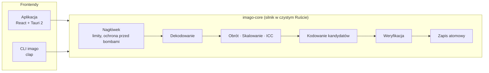

<p align="center">
  
</p>

<h1 align="center">Imago</h1>

<p align="center">
  <b>Szybko. Lokalnie. Mniejsze obrazy. Zero chmury.</b><br>
  Natywna aplikacja desktopowa i CLI do kompresji, konwersji i skalowania obrazów — bez wysyłania ani jednego bajtu poza Twój komputer.
</p>

<p align="center">
  <a href="https://github.com/wiktor-jozwiak/imago/actions/workflows/ci.yml"></a>
  <a href="https://github.com/wiktor-jozwiak/imago/releases/latest"></a>
  <a href="LICENSE"></a>
  
  
  
  
</p>

<p align="center">
  <a href="README.md">🇬🇧 English</a> &nbsp;·&nbsp; <b>🇵🇱 Polski</b>
</p>

<p align="center">
  <a href="#-dlaczego-imago">Dlaczego</a> ·
  <a href="#-funkcje">Funkcje</a> ·
  <a href="#%EF%B8%8F-formaty">Formaty</a> ·
  <a href="#-instalacja">Instalacja</a> ·
  <a href="#%EF%B8%8F-wiersz-poleceń">CLI</a> ·
  <a href="#-wydajność">Wydajność</a> ·
  <a href="#-jak-to-działa">Jak to działa</a> ·
  <a href="#-dokumentacja">Dokumentacja</a>
</p>

---

## ✨ Dlaczego Imago

Optymalizatory online są wygodne — i dostają kopię każdego zdjęcia, które wgrasz. Imago robi to samo **na Twoim procesorze**:

|  | Optymalizatory online | **Imago** |
|---|---|---|
| Pliki opuszczają komputer | ✅ zawsze | ❌ **nigdy** — brak kodu sieciowego, CSP blokuje połączenia |
| Działa offline | ❌ | ✅ |
| Limity liczby / rozmiaru plików | 20 plików, 5 MB… | tysiące plików, 512 MB+ na plik, panoramy 30 000 px |
| Sam dobiera najlepszy format | czasem | ✅ **Tryb auto** porównuje WebP / AVIF / JPEG / PNG i wyjaśnia wybór |
| Może powiększyć plik | czasem | ❌ **nigdy** — jeśli nic nie wygra, zostaje oryginał |
| Konta, reklamy, telemetria | zwykle | ❌ brak |
| Skryptowalność | klucze API, limity | ✅ CLI `imago`, raporty JSON, kody wyjścia |
| Cena | freemium | **darmowy i otwarty (GPL-3.0)** |

> *„Wybrano WebP, bo zmniejszył plik o 71% i zachował przezroczystość.”*
> — Imago wyjaśnia jedną ze swoich decyzji w trybie auto

## 🚀 Funkcje

**Optymalizacja**
- 🤖 **Tryb automatyczny** — koduje kilku kandydatów, zostawia najmniejszego, zachowuje przezroczystość i animacje, mówi *dlaczego*.
- 🎚️ Jakość **1–100**, tryb **bezstratny**, tryb **maksymalnej kompresji** i tryb **szybki** dla dużych paczek.
- 🧠 Stratna kwantyzacja PNG (jak TinyPNG, libimagequant) albo w pełni bezstratny PNG (oxipng).
- 🎞️ Świadomość animacji: animacje GIF / APNG / WebP / AVIF / JPEG XL zostają animacjami, identyczne klatki są łączone.

**Przekształcenia**
- 📐 Skalowanie wg szerokości, wysokości, prostokąta lub procentu — SIMD Lanczos3, bez powiększania, chyba że o to poprosisz.
- 🔄 Automatyczny obrót wg EXIF, zachowanie profilu ICC lub konwersja do sRGB.
- 🕵️ Usuwanie EXIF (GPS, aparat), XMP i komentarzy — **domyślnie włączone**. Metadane JPEG / PNG / WebP można usunąć *bez ponownego kodowania*.
- 🏔️ **Tryb dużych obrazów** — JPEG i PNG ponad limity pikseli (np. panoramy 30 000 px) przetwarzane pasami; pamięć zależy od szerokości, nie od powierzchni.

**Bezpieczeństwo**
- 🛡️ **Zapis atomowy** — wynik trafia do pliku tymczasowego, jest weryfikowany dekodowaniem i dopiero wtedy przenoszony. Oryginały nigdy nie są nadpisywane bez wyraźnej zgody.
- 💣 Sprawdzanie nagłówków *przed* dekodowaniem chroni przed bombami dekompresyjnymi; budżet pamięci ogranicza liczbę jednocześnie dekodowanych obrazów.
- 🧯 Każdy plik działa w `catch_unwind` — wywracający się kodek psuje jeden plik, nie całą paczkę. Kod `unsafe` jest zabroniony w całym workspace.

**Interfejs**
- 🖱️ Przeciągnij i upuść pliki albo całe drzewa folderów, albo użyj natywnego okna wyboru.
- 🔍 Suwak **przed / po** ze statystykami rozmiaru, % oszczędności i czasem przetwarzania.
- 📦 Zapis do `optimized/`, własnego folderu, archiwum ZIP albo „Zapisz jako…” dla pojedynczego obrazu.
- ⏱️ Postęp kolejki i każdego pliku, anulowanie, pomijanie, ponawianie; wirtualizowana lista obsłuży tysiące plików.
- 🌗 Motyw jasny / ciemny / systemowy, interfejs 🇵🇱 polski i 🇬🇧 angielski, skróty klawiszowe, sortowanie i filtrowanie.

**Automatyzacja**
- ⌨️ **CLI `imago`** używa dokładnie tego samego silnika i ustawień co aplikacja.

## 🖼️ Formaty

| Format | Odczyt | Zapis | Animacja | Uwagi |
|---|:---:|:---:|:---:|---|
| **JPEG** | ✅ | ✅ | — | MozJPEG, progresywny + trellis |
| **PNG / APNG** | ✅ | ✅ | ✅ | stratny (libimagequant) lub bezstratny (oxipng) |
| **WebP** | ✅ | ✅ | ✅ | libwebp, stratny i bezstratny |
| **AVIF** | ✅ | ✅ | ✅ | koder oparty na rav1e, 10 bit; tylko stratny |
| **JPEG XL** | ✅ | ✅ | ✅ | stratny i bezstratny, każdy wynik weryfikowany pełnym dekodowaniem |
| **GIF** | ✅ | ✅ | ✅ | zapis przy zachowaniu animacji lub gdy wybrany jawnie |
| **HEIC / HEIF** | ✅ | — | — | zdjęcia z iPhone'a, dekoder w czystym Ruście, 8/10 bit |
| **TIFF** | ✅ | ✅ | — | pierwsza strona; zapis bezstratny |
| **BMP** | ✅ | — | — | |

Obrazy 16-bitowe zostają 16-bitowe w PNG, TIFF i bezstratnym JPEG XL. Szczegóły: **[docs/FORMATS.md](docs/FORMATS.md)**.

## 📥 Instalacja

### Gotowe paczki

Pobierz najnowszą wersję z **[Releases](https://github.com/wiktor-jozwiak/imago/releases/latest)**:

| System | Aplikacja | CLI |
|---|---|---|
| 🪟 Windows | `.msi`, `.exe` | `.zip` |
| 🍎 macOS (universal) | `.dmg` | `.tar.gz` |
| 🐧 Linux | `.deb`, `.rpm`, `.AppImage` | `.tar.gz` |

Każde wydanie zawiera `SHA256SUMS.txt`. Zainstalowana aplikacja potrzebuje tylko systemowego WebView.

### Ze źródeł

```bash
git clone https://github.com/wiktor-jozwiak/imago.git
cd imago
npm install
npm run tauri dev          # aplikacja w trybie deweloperskim
cargo install --path crates/imago-cli   # samo CLI
```

**Narzędzia:** Rust stable ≥ 1.93 · Node.js 20.19+ / 22+ · kompilator C · **NASM** (tylko przy budowaniu) · WebKitGTK na Linuksie.
Pełny przewodnik z buildami wydań: **[docs/INSTALL.md](docs/INSTALL.md)**.

## ⌨️ Wiersz poleceń

```bash
# jeden plik → WebP
imago input.jpg --output optimized.webp --format webp --quality 82

# cały folder, najlepszy format dla każdego obrazu
imago ./photos --output ./optimized --format auto

# rekurencyjnie, 8 wątków, maks. szerokość 2400 px, bez metadanych
imago ./photos --output ./optimized --recursive --workers 8 --max-width 2400 --remove-metadata

# bezstratnie, pomiń już zrobione
imago ./photos --output ./optimized --lossless --skip-existing

# wszystko do ZIP-a plus raport dla maszyn
imago ./photos --zip photos.zip --json
```

<details>
<summary><b>Najprzydatniejsze flagi</b></summary>

| Flaga | Działanie |
|---|---|
| `--format <auto\|original\|jpeg\|png\|webp\|avif\|jxl\|tiff\|gif>` | Format wyjściowy (`auto` = wygrywa najmniejszy, `original` = bez zmiany formatu) |
| `--quality <1-100>` | Jakość, domyślnie `82` |
| `--lossless` / `--max-compression` / `--fast` | Tryb koderów |
| `--width`, `--height`, `--max-width`, `--max-height`, `--scale` | Skalowanie |
| `--keep-metadata`, `--strip-icc`, `--preserve-timestamps` | Metadane |
| `--suffix <TEKST>`, `--flat`, `--overwrite`, `--force` | Nazwy wyników i nadpisywanie |
| `--memory-budget <MB>`, `--max-megapixels <MP>` | Limity bezpieczeństwa |
| `--json`, `--list-formats` | Raporty |

**Kody wyjścia:** `0` ok · `1` część plików z błędem · `2` złe argumenty · `3` nic do zrobienia / błąd krytyczny · `130` Ctrl+C.
Pierwsze Ctrl+C anuluje łagodnie, drugie kończy proces natychmiast.

</details>

Pełny opis: **[docs/CLI.md](docs/CLI.md)**.

## ⚡ Wydajność

Pomiary: Ryzen 7 5700X (8C/16T), jakość 82, build release — pełne tabele w **[docs/PERFORMANCE.md](docs/PERFORMANCE.md)**.

| Kodowanie 1024×768 | Czas |
|---|---|
| JPEG (MozJPEG) | **40 ms** |
| WebP | **60 ms** |
| AVIF | 240 ms |
| PNG stratny | 388 ms |

| Skalowanie | Przepustowość |
|---|---|
| 4000×3000 → 2000×1500, Lanczos3 | **747 Mpx/s** |
| 4000×3000 → miniatura 256 px | **3,7 Gpx/s** |

**Skalowanie na wątki** — 32 zdjęcia → WebP:

```
 1 wątek   ██                         26 plików/s   1,0×
 2 wątki   ████                       42 plików/s   1,6×
 4 wątki   ████████                   80 plików/s   3,1×
 8 wątków  ██████████████            149 plików/s   5,7×
16 wątków  ████████████████████      210 plików/s   8,1×
```

```bash
cargo bench -p imago-core            # zmierz u siebie
```

## 🔧 Jak to działa



- **Workspace:** `crates/imago-core` (silnik) · `crates/imago-cli` (CLI) · `src-tauri` (adapter desktopowy) · `src` (UI w React).
- **Współbieżność:** pula wątków (rdzenie logiczne − 1) pobiera pliki z kolejki; kodeki dodatkowo korzystają ze wspólnej puli `rayon`; budżet pamięci każe wielkim obrazom czekać na swoją kolej.
- **Natywne, statycznie linkowane kodeki:** MozJPEG, libwebp, rav1e/rav1d, libimagequant, oxipng — z SIMD i asemblerem tam, gdzie się da.
- **23-etapowy pipeline** z weryfikacją przed każdym zapisem: **[docs/PIPELINE.md](docs/PIPELINE.md)**.

## 🔒 Prywatność

- 100% przetwarzania lokalnie, działa całkowicie offline.
- Bez kont, logowania, reklam, telemetrii i trackerów.
- Aplikacja nie zawiera kodu sieciowego; Content Security Policy okna blokuje połączenia zewnętrzne.
- Bez sprawdzania aktualizacji — aplikacja nigdy nie „dzwoni do domu”.
- Ustawienia zapisywane lokalnie, bez historii plików; logi diagnostyczne (tylko ścieżki i błędy, nigdy zawartość obrazów) rotowane po 7 dniach.

## 📚 Dokumentacja

| Dokument | Zawartość |
|---|---|
| [INSTALL](docs/INSTALL.md) | Instalacja, środowisko deweloperskie, buildy wydań |
| [CLI](docs/CLI.md) | Wszystkie flagi, kody wyjścia, format raportu JSON |
| [FORMATS](docs/FORMATS.md) | Formaty, tryby konwersji, tryb dużych obrazów |
| [PIPELINE](docs/PIPELINE.md) | 23-etapowy pipeline i zapis atomowy |
| [ARCHITECTURE](docs/ARCHITECTURE.md) | Warstwy, wątki, limity pamięci, anulowanie |
| [PERFORMANCE](docs/PERFORMANCE.md) | Benchmarki i ich uruchamianie |
| [DECISIONS](docs/DECISIONS.md) | Rejestr decyzji architektonicznych (ADR) |
| [LIMITATIONS](docs/LIMITATIONS.md) | Znane ograniczenia |
| [TROUBLESHOOTING](docs/TROUBLESHOOTING.md) | Rozwiązywanie problemów |
| [SIGNING](docs/SIGNING.md) | Podpisywanie instalatorów w CI |

## ⚠️ Znane ograniczenia

- AVIF nie ma trybu bezstratnego; HEIC/HEIF tylko do odczytu (brak kodera HEVC w czystym Ruście).
- JPEG XL nigdy nie jest wybierany w trybie auto (koder jest młody — każdy wynik JXL jest weryfikowany pełnym dekodowaniem).
- MozJPEG, libwebp i oxipng kończą bieżący obraz przed anulowaniem; AVIF i JPEG XL da się przerwać w trakcie.
- Instalatory są podpisywane tylko z certyfikatem skonfigurowanym w CI — bez niego SmartScreen / Gatekeeper może ostrzec. Integralność: `SHA256SUMS.txt`.
- RAW, PSD, SVG i PDF nie są obsługiwane (rozpoznawane i czytelnie odrzucane).

Pełna lista: **[docs/LIMITATIONS.md](docs/LIMITATIONS.md)**.

## 🤝 Współpraca

Zgłoszenia błędów, pomysły i pull requesty mile widziane — zob. **[CONTRIBUTING.md](CONTRIBUTING.md)**.
Luka bezpieczeństwa? Postępuj wg **[SECURITY.md](SECURITY.md)** zamiast otwierać publiczne zgłoszenie.

```bash
cargo test --workspace     # testy silnika i CLI
npm test                   # testy UI
cargo clippy --workspace --all-targets
```

## 📄 Licencja

Imago to wolne oprogramowanie na licencji **[GNU GPL v3.0 lub nowszej](LICENSE)** — wymaganej przez libimagequant (stratny PNG).
Kodeki AVIF i JPEG XL są na AGPL-3.0 i łączone na mocy GPLv3 §13 (ADR-016).
Licencje zależności: **[THIRD_PARTY.md](THIRD_PARTY.md)**.

<p align="center"><sub>Zrobione w 🦀 Ruście · przy tworzeniu tego programu nie wysłano żadnego piksela</sub></p>
