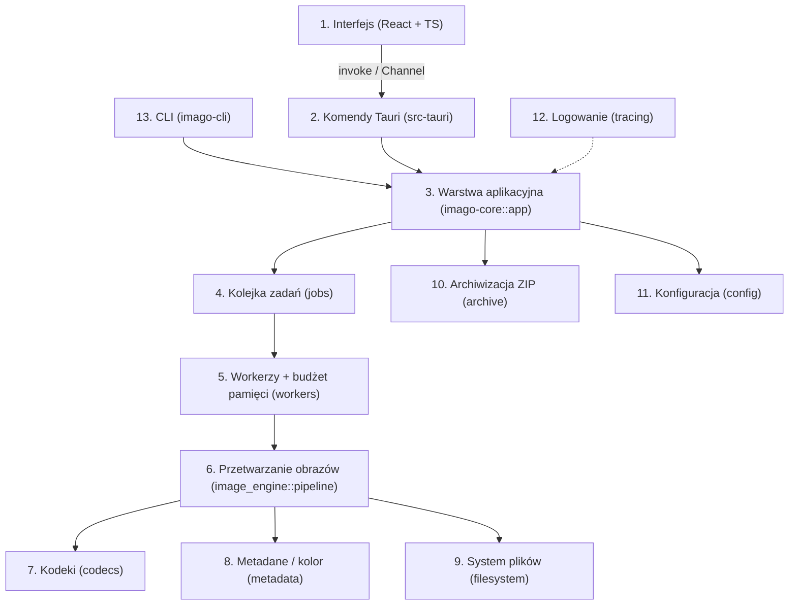

# Imago — architektura

> Dokument opisuje architekturę aplikacji (zaprojektowaną w Etapie 1, zaktualizowaną po implementacji) **Imago — Image Optimizer**
> („Fast. Local. Smaller images.” / „Szybsze obrazy. Mniejsze pliki. Zero chmury.”).
> Decyzje z uzasadnieniem: [DECISIONS.md](DECISIONS.md). Stan realizacji: [PROGRESS.md](PROGRESS.md).

## 1. Analiza wymagań — najważniejsze wnioski

| Obszar | Wniosek projektowy |
|---|---|
| Priorytety 1–2 (poprawność, bezpieczeństwo plików) | Oryginał nigdy nie jest otwierany do zapisu. Każdy wynik powstaje w pliku tymczasowym w katalogu docelowym, jest weryfikowany i dopiero wtedy atomowo przenoszony. Nadpisanie oryginału wymaga jawnej zgody (flaga + potwierdzenie w GUI). |
| Priorytet 3 (lokalność) | Zero kodu sieciowego w backendzie; CSP w webview blokuje połączenia zewnętrzne; brak telemetrii i auto-update. |
| Priorytet 4 (stabilność) | Każdy plik przetwarzany w izolacji: błąd lub `panic` w kodeku kończy się statusem *Błąd* dla tego pliku, a nie awarią aplikacji (`catch_unwind` + `panic = "unwind"`). |
| Priorytet 5 (pamięć) | Kolejka zadań + budżet pamięci (semafor bajtów) ograniczający liczbę jednocześnie zdekodowanych obrazów; limity rozmiaru pliku i liczby pikseli sprawdzane **przed** dekodowaniem. |
| Priorytet 6 (szybkość) | Równoległość na poziomie plików (N workerów), SIMD w resize i kodekach, brak zbędnych kopii buforów. |
| „CLI i GUI korzystają z tego samego silnika” | Cała logika w bibliotece `imago-core`; GUI (Tauri) i CLI to cienkie adaptery. |
| Formaty | Statycznie linkowane kodeki — gotowa aplikacja nie ma zależności runtime. |

## 2. Warstwy



| # | Warstwa | Lokalizacja | Odpowiedzialność |
|---|---|---|---|
| 1 | Interfejs | `src/` (React, TypeScript, Vite) | Widoki, stan UI (zustand), skróty klawiszowe, i18n PL/EN, motyw. Zero logiki przetwarzania. |
| 2 | Komendy Tauri | `src-tauri/src/commands.rs` | Mapowanie IPC ↔ API `imago-core`, walidacja wejścia, strumień zdarzeń przez `tauri::ipc::Channel`. |
| 3 | Aplikacyjna | `imago-core/src/app.rs` | Fasada: skanowanie wejść, uruchamianie zadań, podgląd, eksport, ZIP. Wspólna dla GUI i CLI. |
| 4 | Kolejka zadań | `imago-core/src/jobs.rs` | Model zadania (`JobSpec`, `FileTask`), statusy, zdarzenia postępu, podsumowanie, kontroler anulowania. |
| 5 | Workerzy | `imago-core/src/workers.rs` | Pula N wątków, kolejka MPMC, budżet pamięci, izolacja paniki, pomijanie pojedynczych plików. |
| 6 | Przetwarzanie obrazów | `imago-core/src/image_engine/` | Wykrywanie formatu, analiza, dekodowanie, orientacja, resize, konwersja kolorów, pipeline 23 kroków, tryb auto. |
| 7 | Kodeki | `imago-core/src/codecs/` | Enkodery/dekodery per format, rejestr możliwości (`capabilities`). |
| 8 | Metadane | `imago-core/src/metadata.rs` | EXIF (orientacja), ICC (zachowanie / konwersja do sRGB), bezstratne usuwanie metadanych z kontenera, czasy plików. |
| 9 | System plików | `imago-core/src/filesystem/` | Skanowanie (walkdir), ukryte pliki, ścieżki wyjściowe, ochrona przed path traversal, konflikty nazw, bezpieczny zapis atomowy. |
| 10 | Archiwizacja | `imago-core/src/archive.rs` | Strumieniowe tworzenie ZIP (metoda *Stored*, ZIP64), sanityzacja nazw wpisów. |
| 11 | Konfiguracja | `imago-core/src/config.rs` | `AppConfig` (JSON, wersjonowany), atomowy zapis, walidacja i migracja. |
| 12 | Logowanie | `tracing` w core; inicjalizacja subskrybenta w binarkach | GUI: plik rotowany w katalogu danych aplikacji; CLI: stderr (`-q`/`-v`). |
| 13 | CLI | `crates/imago-cli` | `clap`, postęp, kody wyjścia, Ctrl+C → anulowanie. |

## 3. Struktura katalogów

```
Imago/
├── Cargo.toml                  # workspace: crates/imago-core, crates/imago-cli, src-tauri
├── Cargo.lock
├── package.json / vite.config.ts / tsconfig*.json / index.html
├── README.md, CONTRIBUTING.md, SECURITY.md, LICENSE (GPL-3.0-or-later), THIRD_PARTY.md
├── docs/                       # SPEC, ARCHITECTURE, DECISIONS, PROGRESS, REQUIREMENTS, CLI, FORMATS, ...
├── src/                        # frontend React
│   ├── main.tsx, App.tsx
│   ├── components/             # Dropzone, FileList, FileCard, SettingsPanel, ProgressBar,
│   │                           # SummaryPanel, ThemeToggle, PreviewDialog, ...
│   ├── hooks/  services/  store/  styles/  types/  utils/  i18n/
├── src-tauri/                  # pakiet `imago-app` — wyłącznie adapter Tauri
│   ├── Cargo.toml, build.rs, tauri.conf.json, capabilities/, icons/
│   └── src/ main.rs, lib.rs, commands.rs, state.rs, logging.rs, errors.rs
├── crates/
│   ├── imago-core/             # silnik (biblioteka) — bez zależności od Tauri
│   │   ├── src/
│   │   │   ├── lib.rs, app.rs, errors.rs, config.rs, jobs.rs, workers.rs,
│   │   │   ├── cancel.rs, settings.rs, metadata.rs, archive.rs, preview.rs
│   │   │   ├── filesystem/ (scan.rs, paths.rs, safe_write.rs)
│   │   │   ├── image_engine/ (detection.rs, probe.rs, decode.rs, resize.rs, color.rs,
│   │   │   │                  auto.rs, animation.rs, pipeline.rs)
│   │   │   └── codecs/ (capabilities.rs, jpeg.rs, png.rs, quantize.rs, webp.rs,
│   │   │                webp_mux.rs, avif.rs, tiff.rs, gif.rs, jxl.rs)
│   │   ├── tests/              # codecs, engine, pipeline, scan, security + common/ (generator obrazów)
│   │   └── benches/            # Criterion: codecs.rs, pipeline.rs
│   └── imago-cli/              # binarka `imago`
│       ├── src/ main.rs, args.rs, report.rs
│       └── tests/cli.rs        # testy CLI (assert_cmd)
├── src/                        # interfejs: components/ (+ ui/), hooks/, i18n/, services/, store/, styles/, types/, utils/
├── deny.toml                   # polityka licencji i źródeł zależności (cargo-deny)
└── .github/workflows/          # ci.yml, release.yml, audit.yml
```

**Zmiany względem struktury proponowanej w specyfikacji** (uzasadnienie w [DECISIONS.md](DECISIONS.md)):

1. **Workspace z trzema crate'ami zamiast jednego crate'a w `src-tauri`.** Specyfikacja wymaga, by główny crate nazywał się `imago-core`, by CLI i Tauri były oddzielone od silnika i korzystały z tych samych struktur. Osobny crate biblioteczny wymusza to na poziomie kompilatora: `imago-core` nie może zależeć od Tauri, a CLI nie ciągnie WebView.
2. **`cli.rs` → osobny crate `imago-cli`** z binarką `imago` (CLI nie potrzebuje Tauri/WebView; build i dystrybucja są niezależne).
3. **`benches/` i `tests/` wewnątrz `crates/imago-core`** — Criterion i testy integracyjne muszą należeć do crate'a, który testują.
4. **`codecs/` jako katalog** (jeden plik na format) zamiast jednego `codecs.rs` — każdy kodek ma własne ustawienia i testy.
5. **Dodatkowe moduły:** `cancel.rs` (token anulowania), `settings.rs` (wspólne struktury ustawień GUI/CLI), `preview.rs` (miniatury i podgląd), `image_engine/probe.rs` (analiza nagłówków — kroki 4–9), `image_engine/auto.rs` (tryb automatyczny), `image_engine/animation.rs`, `codecs/quantize.rs` (libimagequant), `codecs/webp_mux.rs` (kontener animowanego WebP, ADR-012), `codecs/apng.rs` (muxer APNG, ADR-017) i `image_engine/streaming.rs` (tryb dużych obrazów, ADR-018).

## 4. Wybór technologii

### 4.1 Silnik obrazów: statycznie linkowane kodeki zamiast libvips

Specyfikacja preferuje libvips „jeśli zapewni najlepszą wydajność i stabilność”. Po analizie **nie wybieram libvips jako silnika głównego** (ADR-001):

- libvips to zależność **runtime** — na Windows kilkadziesiąt DLL do dołączenia do instalatora, na macOS relokacja i podpisywanie dylibów z Homebrew, na Linux różne wersje w dystrybucjach. To największe ryzyko dla priorytetu 4 (stabilność) i dla prostoty instalacji.
- Crate `libvips` to generowane FFI wymagające nagłówków, pkg-config i globalnej inicjalizacji; obsługa błędów przez globalny bufor. Więcej `unsafe` na styku z aplikacją.
- Przewaga libvips (strumieniowe, leniwe potoki dla obrazów gigapikselowych) ma znaczenie głównie powyżej limitów, które i tak nakładamy. Dla typowych zdjęć i grafik czas zdominowany jest przez **enkodery** — a te są te same (mozjpeg, libwebp, AV1, libimagequant), tylko linkowane bezpośrednio.
- Wybrany zestaw buduje się ze źródeł (`cc`/NASM) i jest linkowany statycznie: **gotowa aplikacja nie ma zależności runtime**.

Warstwa `image_engine` oddziela pipeline od kodeków, więc backend libvips da się dodać w przyszłości jako opcjonalny feature bez zmian w GUI/CLI.

### 4.2 Zależności

**`imago-core`** (silnik):

| Crate | Wersja | Rola | Licencja | Natywny kod |
|---|---|---|---|---|
| `image` | 0.25 | dekodowanie JPEG/PNG/GIF/WebP/TIFF/BMP, bufory pikseli, limity | MIT/Apache-2.0 | nie |
| `mozjpeg` | 0.10 | koder JPEG (trellis, progresywny, optymalizacja Huffmana) | IJG/Zlib/BSD | C + NASM |
| `webp` (`libwebp-sys`) | 0.3 | koder WebP stratny/bezstratny, animacje | MIT/BSD-3 (libwebp) | C |
| `zenavif` (`zenravif`, `zenrav1e`, `rav1d-safe`) | 0.1 | koder AVIF (obrazy i animacje), dekoder animowanego AVIF | **AGPL-3.0** (ADR-016) | Rust + NASM |
| `avif-decode` (`rav1d`) | 3.0 | dekoder AVIF (obrazy statyczne) | BSD-2/BSD-3 | Rust + NASM |
| `zenavif-parse` | 0.6 | kontener AVIF (wymiary, animacja, `irot`/`imir`, ICC, EXIF) bez dekodowania | MPL-2.0 | nie |
| `oxipng` | 10 | bezstratna optymalizacja PNG (libdeflate, zopfli) | MIT | C (libdeflate) |
| `imagequant` | 4 | kwantyzacja palety (stratny PNG, GIF) | **GPL-3.0-or-later** | nie |
| `gif` | 0.14 | koder GIF (zachowanie animacji) | MIT/Apache-2.0 | nie |
| `tiff` | 0.11 | koder TIFF z kompresją Deflate/LZW | MIT | nie |
| `jxl-oxide` | 0.12 | dekoder JPEG XL | MIT/Apache-2.0 | nie |
| `jxl-encoder` | 0.3 | koder JPEG XL (stratny, bezstratny, animacje) | **AGPL-3.0** (ADR-016) | nie |
| `heic-rs` | 0.1 | dekoder HEIC/HEIF (HEVC w czystym Ruście, bez `unsafe`) | MIT/Apache-2.0 | nie |
| `png` | 0.18 | strumieniowy odczyt i zapis PNG (tryb dużych obrazów) | MIT/Apache-2.0 | nie |
| `fast_image_resize` | 6 | skalowanie SIMD (Lanczos3, premultiplied alpha) | MIT/Apache-2.0 | nie |
| `moxcms` | 0.9 | zarządzanie kolorem (ICC → sRGB) | BSD-3/Apache-2.0 | nie |
| `img-parts` | 0.4 | bezstratna edycja kontenerów JPEG/PNG/WebP (usuwanie metadanych bez rekodowania) | MIT/Apache-2.0 | nie |
| `tempfile` | 3 | bezpieczne pliki tymczasowe, atomowe `persist` / `persist_noclobber` | MIT/Apache-2.0 | nie |
| `same-file` | 1 | niezawodne porównanie „czy to ten sam plik” (ochrona oryginału) | MIT/Unlicense | nie |
| `walkdir` | 2 | rekurencyjne skanowanie | MIT/Unlicense | nie |
| `zip` | 8 | archiwa ZIP (bez kompresji — obrazy są już skompresowane) | MIT | nie |
| `crossbeam-channel` | 0.5 | kolejka MPMC dla workerów | MIT/Apache-2.0 | nie |
| `rayon` | 1 | równoległe skanowanie/probe; wewnętrznie używany przez kodeki | MIT/Apache-2.0 | nie |
| `serde`, `serde_json` | 1 | konfiguracja, IPC | MIT/Apache-2.0 | nie |
| `thiserror` | 2 | ustandaryzowane błędy | MIT/Apache-2.0 | nie |
| `tracing` | 0.1 | logowanie strukturalne | MIT | nie |
| `directories` | 6 | ścieżki konfiguracji/logów per platforma | MIT/Apache-2.0 | nie |
| `rgb`, `imgref`, `zenpixels` | 0.8 / 1.12 / 0.2 | typy pikseli dla koderów | MIT/Apache-2.0/CC0 | nie |
| `enough`, `almost-enough` | 0.4 | przerywanie kodowania AVIF/JPEG XL w trakcie obrazu | MIT/Apache-2.0 | nie |

Dev: `criterion` 0.8 (benchmarki). Liczba rdzeni: `std::thread::available_parallelism` (bez `num_cpus`). Pliki tymczasowe: `tempfile` (bez `uuid`).

**`imago-app`** (Tauri): `tauri` 2.12, `tauri-build` 2.7, `tauri-plugin-dialog` 2.8, `tauri-plugin-opener` 2.6, `tracing-subscriber`, `tracing-appender`, `anyhow`.

**`imago-cli`**: `clap` 4 (derive), `ctrlc` 3, `indicatif` 0.18, `tracing-subscriber`, `anyhow`; dev: `assert_cmd`, `predicates`, `tempfile`.

**Frontend**: React 19, TypeScript 7, Vite 8, `@tauri-apps/api` 2, `zustand` 5; testy: Vitest + Testing Library + jsdom. Okna dialogowe plików są wywoływane po stronie Rusta (`tauri-plugin-dialog`), więc webview nie potrzebuje uprawnień do systemu plików. Style: nowoczesny CSS z custom properties (bez Tailwind — mniej zależności, pełna kontrola nad motywami).

**Narzędzia build-time**: kompilator C (MSVC / clang / gcc), **NASM** (x86/x86_64), Rust stable ≥ 1.93. Na macOS i Linux dodatkowo zależności systemowe Tauri (WebKit). Szczegóły w `docs/INSTALL.md` (Etap 8).

## 5. Obsługa formatów

| Format | Dekodowanie | Kodowanie | Tryby | Alfa | Animacja | Uwagi |
|---|---|---|---|---|---|---|
| JPEG | `image` (zune-jpeg; CMYK→RGB) | `mozjpeg` | stratny | — | — | progresywny, trellis, 4:2:0 / 4:4:4 przy wysokiej jakości |
| PNG | `image` (+APNG) | `imagequant` + `oxipng` (APNG: własny muxer, ADR-017) | stratny (paleta), bezstratny | ✓ | ✓ | stratny = kwantyzacja do ≤256 kolorów z ditheringiem |
| WebP | `image` (image-webp) | `libwebp` + własny muxer (ADR-012, ADR-017) | stratny, bezstratny | ✓ | ✓ | max 16383 px na bok |
| AVIF | `avif-decode` (rav1d), animacje: `zenavif` | `zenavif` (zenrav1e) | stratny | ✓ | ✓ | koder wolniejszy — ograniczany w trybie auto |
| TIFF | `image` | `tiff` (Deflate) | bezstratny | ✓ | — (tylko 1. strona) | |
| BMP | `image` | — | — | ✓ | — | tylko wejście |
| GIF | `image` | `gif` + `imagequant` | paleta | ✓ (1-bit) | ✓ | wyjście GIF tylko przy zachowaniu animacji |
| JPEG XL | `jxl-oxide` | `jxl-encoder` | stratny, bezstratny | ✓ | ✓ | eksperymentalny: każdy wynik weryfikowany dekodowaniem |
| HEIC/HEIF | `heic-rs` | — | — | ✓ | — | tylko wejście; „Zachowaj format” → JPEG |

**Rejestr możliwości** (`codecs::capabilities()`) zwraca dla każdego formatu: czy dekodowanie/kodowanie jest dostępne w tym buildzie, obsługiwane tryby, alfa, animacja, limity wymiarów, oraz — gdy niedostępny — powód, **alternatywę** i instrukcję włączenia. GUI wyszarza niedostępne opcje; CLI zwraca czytelny błąd. Ciężkie kodeki (`avif`, `jxl`) są cargo-feature'ami włączonymi domyślnie; build bez nich działa i poprawnie raportuje brak formatu.

**Wykrywanie formatu** nigdy nie ufa rozszerzeniu: czytane są pierwsze bajty (magic numbers: `FF D8 FF`, `89 PNG`, `RIFF....WEBP`, `ftyp` z markami `avif/avis/mif1`, `II*\0`/`MM\0*`, `BM`, `GIF87a/89a`, `FF 0A` / kontener JXL, `ftypheic` → HEIC). Niezgodność z rozszerzeniem → ostrzeżenie w wyniku, przetwarzanie według prawdziwego formatu.

## 6. Pipeline przetwarzania pliku

Funkcja `image_engine::pipeline::process_file` realizuje 23 kroki specyfikacji. Każdy krok: zwraca `Result<_, ImagoError>`, sprawdza token anulowania, jest mierzony (`StageTimings`) i logowany (`tracing` span per plik).

| Krok | Implementacja |
|---|---|
| 1. Walidacja ścieżki | istnieje, jest zwykłym plikiem, nie jest katalogiem/urządzeniem |
| 2. Uprawnienia | otwarcie do odczytu; `PermissionDenied` → kontrolowany błąd |
| 3. Rozmiar pliku | `metadata.len() ≤ limits.max_file_bytes` |
| 4–5. Sygnatura, prawdziwy format | `detection::sniff` (pierwsze 64 B) |
| 6. Wymiary bez dekodowania | nagłówek przez `ImageReader::into_dimensions` / `avif-parse` / `jxl-oxide`; limit pikseli **przed** alokacją |
| 7. Animacja | GIF: liczba klatek; WebP: flaga ANIM w VP8X; PNG: chunk `acTL`; AVIF: marka `avis` |
| 8. Kanał alfa | typ koloru z nagłówka; po dekodowaniu sprawdzenie, czy alfa jest faktycznie używana |
| 9. Metadane | orientacja EXIF, profil ICC, obecność EXIF/XMP |
| 10. Wybór ustawień | `auto::plan` (tryb auto) albo ustawienia użytkownika → lista kandydatów |
| 11. Dekodowanie | z `image::Limits` (maks. alokacja) po rezerwacji budżetu pamięci |
| 12. Orientacja EXIF | `DynamicImage::apply_orientation` |
| 13. Zmiana wymiarów | `fast_image_resize`, Lanczos3, alfa premultiplikowana, bez powiększania domyślnie |
| 14. Przestrzeń kolorów | 16→8 bit gdy format wymaga; ICC ≠ sRGB i profil ma być usunięty → konwersja do sRGB (`moxcms`) |
| 15. Metadane wyjściowe | EXIF usuwany domyślnie; ICC zachowany gdy ≠ sRGB i użytkownik chce |
| 16. Kodowanie | każdy kandydat; większe wyniki zwalniane natychmiast |
| 17–18. Porównanie, wybór | najmniejszy wariant; w auto i przy tym samym formacie: oryginał (ew. bezstratnie oczyszczony z metadanych), jeśli nic nie jest mniejsze |
| 19. Plik tymczasowy | `tempfile` w katalogu docelowym |
| 20. Weryfikacja | odczyt z dysku bajt w bajt + rozpoznanie sygnatury formatu |
| 21. Atomowe przeniesienie | `persist_noclobber` lub `persist` (tylko przy zgodzie na nadpisanie) |
| 22–23. Postęp, wynik | zdarzenie `FileFinished` z `FileReport` (rozmiary, redukcja, czasy, decyzja auto) |

## 7. Wielowątkowość

- **Równoległość na poziomie plików.** Zadanie (`JobSpec`) to lista `FileTask`. Koordynator tworzy `N` wątków (`std::thread::scope`), domyślnie `max(1, logiczne_rdzenie − 1)`, konfigurowalne. Wątki pobierają zadania z kolejki MPMC (`crossbeam-channel`) aż do jej opróżnienia lub anulowania.
- **Dlaczego własne wątki, a nie `rayon::par_iter`:** workerzy blokują się na budżecie pamięci (Condvar) — blokowanie w wątkach puli rayon zagłodziłoby kodeki, które same używają rayon (rav1e, oxipng, imagequant). Kodeki korzystają z globalnej puli rayon, workerzy są poza nią.
- **Wątek UI nigdy nie jest blokowany.** Komenda `start_job` uruchamia koordynatora w osobnym wątku i natychmiast zwraca `JobId`; postęp płynie przez `tauri::ipc::Channel` (uporządkowany strumień). Frontend buforuje zdarzenia i odświeża stan co ~100 ms (duże paczki nie zalewają Reacta).
- **Izolacja błędów.** Przetwarzanie każdego pliku jest owinięte w `std::panic::catch_unwind`; panika kodeka = status *Błąd* dla pliku (`internal_error`), reszta kolejki działa dalej.

## 8. Zarządzanie pamięcią i duże pliki

1. **Limity przed dekodowaniem** (konfigurowalne): maks. rozmiar pliku (domyślnie 512 MiB), maks. bok (domyślnie 32 768 px), maks. liczba pikseli (domyślnie 150 MP). Wymiary czytane z nagłówka — obraz-bomba (np. PNG 100 000 × 100 000) jest odrzucany bez alokacji.
2. **Budżet pamięci** (`workers::MemoryBudget`): przed dekodowaniem worker rezerwuje szacowaną pamięć (`szer × wys × bajty_na_piksel × współczynnik_potoku + 2 × rozmiar_pliku`). Suma rezerwacji ≤ budżet (domyślnie 2 GiB, konfigurowalny w ustawieniach zaawansowanych i `--memory-budget`). Duże obrazy czekają, aż zwolni się miejsce; obraz większy niż cały budżet jest przetwarzany sam (bez zakleszczenia).
3. **`image::Limits`** jako druga linia obrony (maks. alokacja w dekoderze).
4. **Brak ładowania wszystkich plików**: skanowanie zwraca tylko ścieżki i metadane; bajty pliku czytane są dopiero przez workera.
5. **Minimalizacja kopii**: dekodowanie bezpośrednio do bufora docelowego, resize do nowego bufora z natychmiastowym zwolnieniem źródła, kandydaci kodowania trzymani tylko gdy są najlepsi.
6. **Animacje strumieniowo**: klatki dekodowane iteratorem i od razu przekazywane do `WebPAnimEncoder`; limit łącznej liczby pikseli animacji.
7. **Miniatury**: generowane leniwie tylko dla widocznych wierszy (wirtualizowana lista), z pamięci podręcznej po stronie frontendu.

## 9. Anulowanie

- `CancelToken` = `Arc<AtomicBool>` z opcjonalnym rodzicem. Token zadania (anuluj wszystko) + token per plik (pomiń plik); token pliku jest anulowany, gdy anulowany jest rodzic.
- Sprawdzany między wszystkimi krokami pipeline'u i między kandydatami kodowania; w pętli animacji — między klatkami.
- Granularność: wywołanie pojedynczego kodera C (np. kodowanie jednego obrazu AVIF) nie jest przerywane w środku — anulowanie zadziała po jego zakończeniu. Udokumentowane jako ograniczenie.
- Pliki tymczasowe są obiektami RAII (`NamedTempFile`) — usuwane automatycznie przy anulowaniu, błędzie i panice. Po awarii procesu (np. zabicie) zostają pliki `.imago-*.tmp` w katalogu docelowym — czyszczone przy kolejnym zadaniu w tym katalogu (tylko pliki o tym wzorcu, starsze niż 1 h).
- CLI: Ctrl+C → anulowanie tokenu zadania → sprzątanie → kod wyjścia 130.

## 10. Bezpieczny zapis

1. `tempfile::Builder::new().prefix(".imago-").suffix(".tmp").tempfile_in(katalog_docelowy)` — ten sam system plików co cel, więc przeniesienie jest atomowe; losowa nazwa, tworzenie z `O_EXCL`, uprawnienia 0600.
2. Zapis wyniku, `flush`.
3. Weryfikacja: ponowny odczyt pliku tymczasowego z dysku i porównanie bajt w bajt z zakodowanym wynikiem oraz rozpoznanie formatu z sygnatury (poprawność samego kodowania gwarantują testy kodeków, a dla JPEG XL pełny round-trip w koderze); niezgodność → błąd `verification_failed`, plik usuwany.
4. `sync_all()` (fsync) — domyślnie włączone (priorytet bezpieczeństwa > szybkość).
5. Atomowe przeniesienie: `persist_noclobber` (nie nadpisze istniejącego pliku nawet przy wyścigu) albo `persist` — tylko przy polityce *Nadpisz*. Na Windows `MoveFileExW`, na Unix `rename`/`renameat2(RENAME_NOREPLACE)`/`link`.
6. Plik tymczasowy znika (przeniesiony albo usunięty przez `Drop`). Uprawnienia pliku wynikowego na Unix są kopiowane z oryginału.

Ochrona oryginału: wynik nigdy nie jest zapisywany przez otwarcie oryginału; jeśli ścieżka wynikowa wskazuje na ten sam plik co wejście (`same-file`), wymagana jest jawna zgoda (`allow_overwrite_originals`), a i wtedy zapis przechodzi przez plik tymczasowy — awaria w trakcie nie uszkodzi oryginału.

## 11. Tryb automatyczny

`image_engine::auto` klasyfikuje obraz (`ImageKind`: zdjęcie, grafika o małej liczbie kolorów, ikona, obraz z przezroczystością, animacja) na podstawie: liczby unikalnych kolorów (próbkowanie z limitem), używania alfy, wymiarów, formatu i rozmiaru źródła. Dla klasy tworzy listę kandydatów:

| Klasa | Kandydaci |
|---|---|
| Zdjęcie | WebP (q), JPEG (q, mozjpeg), AVIF (q) — AVIF pomijany w trybie „szybkim” dla bardzo dużych obrazów tylko jeśli budżet czasu przekroczony (konfigurowalne) |
| Zdjęcie z alfą | WebP (q), PNG (paleta lub bezstratny), AVIF |
| Prosta grafika / ikona | PNG (paleta, oxipng), WebP bezstratny |
| Animacja | animowany WebP, oryginał (GIF) |

Zwycięża najmniejszy wynik. Jeśli żaden nie jest mniejszy od oryginału — zachowywany jest oryginał (ewentualnie bezstratnie oczyszczony z metadanych), chyba że użytkownik wymusi konwersję. Alfa nigdy nie jest usuwana, jeśli jakikolwiek piksel ma alfę < 255. Wynik zawiera uzasadnienie, np. *„Wybrano WebP, ponieważ zmniejszył rozmiar pliku o 71% i zachował przezroczystość.”*

## 12. Błędy

`ImagoError` (thiserror) z wariantami m.in.: `NotFound`, `PermissionDenied`, `DiskFull`, `Io`, `FileTooLarge`, `DimensionsTooLarge`, `UnsupportedFormat`, `FormatUnavailable {format, reason, alternative}`, `Decode`, `Encode`, `CorruptFile`, `OutputExists`, `WouldOverwriteOriginal`, `PathTraversal`, `VerificationFailed`, `Cancelled`, `InvalidSettings`, `Archive`, `Config`, `Internal`. Każdy wariant ma stabilny `code()` (np. `disk_full`) — GUI tłumaczy go na komunikat PL/EN, a szczegóły techniczne trafiają do logu. Kod produkcyjny nie używa `unwrap()` na danych zewnętrznych.

## 13. Bezpieczeństwo

- Ścieżki wyjściowe budowane wyłącznie z komponentów `Normal` ścieżki względnej (`strip_prefix` korzenia wejścia) + sprawdzenie, że wynik leży pod katalogiem docelowym. Nazwy wpisów ZIP sanityzowane tak samo.
- Unicode: wyłącznie `Path`/`OsStr` w silniku; `to_string_lossy` tylko do wyświetlania. Ścieżki nie-UTF-8 obsługuje CLI; GUI (IPC JSON) raportuje je czytelnie.
- Skanowanie nie wchodzi w dowiązania symboliczne do katalogów (brak pętli i ucieczek poza wybrany folder).
- Brak wywołań procesów zewnętrznych na podstawie danych użytkownika; otwieranie folderu wynikowego przez API systemu (plugin `opener`), nie przez powłokę.
- Tauri: jedyne uprawnienie webview to `core:default`; restrykcyjne CSP (`connect-src ipc:` — brak sieci); brak protokołu `asset`; dialogi plików po stronie Rusta; miniatury, podgląd, eksport i „pokaż w folderze” tylko dla ścieżek z rejestru sesji (dodanych przez użytkownika lub zapisanych przez Imago).
- Konfiguracja nie przechowuje historii plików ani treści obrazów.

## 14. Ryzyka techniczne

| Ryzyko | Wpływ | Mitygacja |
|---|---|---|
| Kompilacja kodeków C/ASM na 3 platformach (mozjpeg, libwebp, rav1e/rav1d, libdeflate) | build CI | NASM w CI (`ilammy/setup-nasm`), cache, macierz Win/macOS/Linux od Etapu 2 |
| Wolne kodowanie AVIF (rav1e) | czas trybu auto | ograniczenie AVIF przy dużych obrazach w trybie auto, `speed` zależny od trybu, benchmarki |
| Czas kompilacji debug (kodeki bez optymalizacji ~50× wolniejsze) | testy | `[profile.dev.package."*"] opt-level = 3` |
| Panika w dekoderze przy złośliwym pliku | stabilność | `panic = "unwind"` + `catch_unwind` per plik (odstępstwo od `panic = "abort"`, ADR-004) |
| Obrazy-bomby / ogromne animacje | pamięć | limity z nagłówka, budżet pamięci, limit pikseli animacji |
| Różnice semantyki rename na Windows (pliki otwarte przez inne procesy, antywirus) | zapis | `tempfile::persist` z obsługą błędów, ponowienie przez użytkownika, oryginał nietknięty |
| Brak stabilnego stratnego kodera JPEG XL bez CMake | format | JXL: dekodowanie + bezstratny zapis; komunikat dla trybu stratnego |
| Licencja GPL-3 (libimagequant) | dystrybucja | cały projekt GPL-3.0-or-later (ADR-002), zależności zgodne |
| Duże paczki (10k+ plików) w UI | responsywność | wirtualizacja listy, batching zdarzeń, leniwe miniatury |
| Nowe wersje narzędzi frontendu (Vite 8, TS 7) | build | przypięte wersje w `package-lock.json`, fallback do starszych majorów przy problemach |

## 15. Plan implementacji

Etapy 1–8 zgodnie ze specyfikacją; szczegółowa lista zadań i status w [PROGRESS.md](PROGRESS.md), mapowanie wymagań na implementację w [REQUIREMENTS.md](REQUIREMENTS.md).
